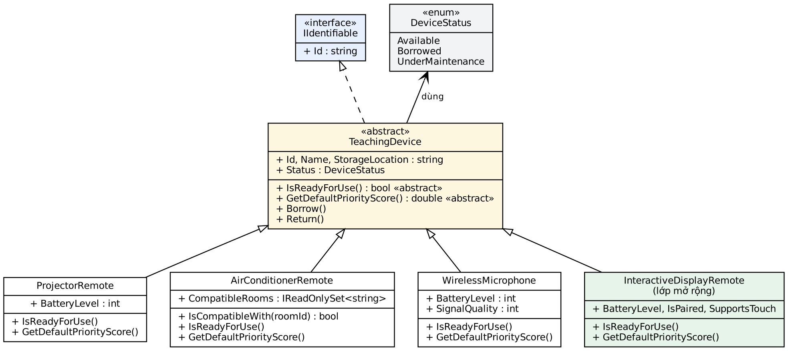
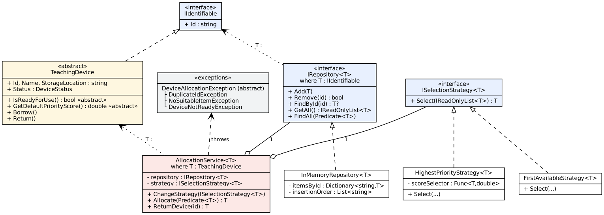

# Quản lý & cấp phát thiết bị dạy học (Lab W07 — Đa hình & Generic, C#)

- Mã sinh viên: `202418915`
- Họ tên: `Phạm Quốc Huy`

## Chạy chương trình

Yêu cầu .NET SDK 8.0 trở lên.

```bash
cd src
dotnet run
```

Chương trình chạy 11 nhóm kiểm thử theo mục 9 của đề và in `TỔNG KẾT: 27 PASS, 0 FAIL`.
Kết quả mẫu: [`ketqua_chay.txt`](ketqua_chay.txt).

## Cấu trúc mã nguồn

```
src/
├── Models/
│   ├── DeviceStatus.cs              enum trạng thái
│   ├── IIdentifiable.cs             interface có mã định danh
│   ├── TeachingDevice.cs            lớp trừu tượng cơ sở
│   ├── ProjectorRemote.cs           điều khiển máy chiếu
│   ├── AirConditionerRemote.cs      điều khiển điều hòa
│   ├── WirelessMicrophone.cs        micro không dây
│   └── InteractiveDisplayRemote.cs  loại mới — chứng minh mở rộng không sửa lớp cũ
├── Exceptions/Exceptions.cs         DuplicateId / NoSuitableItem / DeviceNotReady
├── Repositories/
│   ├── IRepository.cs               IRepository<T> where T : IIdentifiable
│   └── InMemoryRepository.cs        cài đặt bằng Dictionary + thứ tự thêm
├── Strategies/
│   ├── ISelectionStrategy.cs
│   ├── HighestPriorityStrategy.cs
│   └── FirstAvailableStrategy.cs
├── Services/AllocationService.cs    AllocationService<T> where T : TeachingDevice
└── Program.cs                       kiểm thử
docs/                                sơ đồ lớp (Graphviz .dot + .png)
```

## Sơ đồ lớp




## Quyết định thiết kế chính

- **Đa hình** ở `TeachingDevice.IsReadyForUse()` / `GetDefaultPriorityScore()` và ở `ISelectionStrategy<T>.Select()`;
  `AllocationService<T>` không có bất kỳ `if (device is ...)` nào.
- **Generic** ở `IRepository<T>`, `InMemoryRepository<T>`, `ISelectionStrategy<T>`, `AllocationService<T>`
  — một lần viết, dùng cho mọi loại thiết bị, an toàn kiểu tại thời điểm biên dịch.
- **Trade-off:** dùng `Dictionary<string,T>` cho `FindById` O(1) và chống trùng mã nhanh,
  đổi lại tốn thêm bộ nhớ và phải giữ thêm `List<string>` để bảo toàn thứ tự thêm vào.
